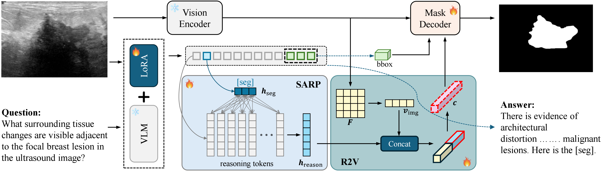

# From Reasoning to Pixels: Grounded Medical Multimodal LLMs for VQA and Segmentation
## Abstract
Although Multimodal Large Language Models (MLLMs) have demonstrated impressive performance in Medical Visual Question Answering (Med-VQA), their reliance on global image features often lacks precise pixel-level grounding, thereby limiting clinical trustworthiness. To bridge the semantic gap between high-level clinical reasoning and spatial localization, we propose MedREAL (Medical REasoning-driven Answering and Localization), a unified framework that seamlessly aligns linguistic reasoning with spatial grounding. Specifically, MedREAL introduces Seg Anchored Reasoning Pooling (SARP) to distill task-relevant semantic evidence directly from [SEG] tokens within the MLLM's hidden states. Furthermore, a Reasoning-to-Visual (R2V) fusion mechanism is proposed to effectively inject these reasoning-aware features into a segmentation pipeline for accurate mask decoding. To facilitate this paradigm, we construct MedRAVS-13K, a comprehensive dataset comprising 13,824 expertly validated samples across four diverse imaging modalities. Extensive experiments demonstrate that MedREAL significantly outperforms state-of-the-arts, achieving 68.49% gIoU and 70.47% cIoU on benchmark evaluations. By generating evidence masks that are strictly consistent with textual diagnoses, MedREAL provides a robust, interpretable framework for reasoning-driven medical image analysis.

## Our code will be released soon.